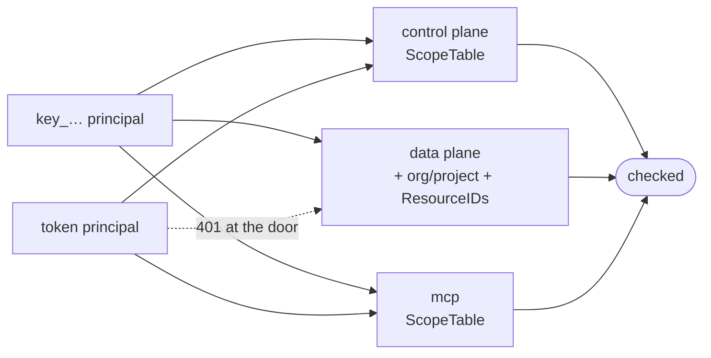

# Scopes

Wire contract. Keys store these exact strings; integrators type them; MCP hosts read them from
the metadata document. **Additive only** — renaming one invalidates keys in the field.

Defined in `internal/platform/authn/scope.go`, one `catalog` row per scope with its level.
`authn.Mintable()` gates minting; `authn.Valid()` still accepts a retired scope on an existing key.

## Catalog

| Scope                | Level   | Grants                                                                   |
| -------------------- | ------- | ------------------------------------------------------------------------ |
| `sheets:read`        | project | List and get sheets; read published rows; list projects (`project_list`) |
| `sheets:write`       | project | Write rows through the data plane                                        |
| `sheets:admin`       | project | Create, update and delete sheets                                         |
| `spreadsheets:read`  | project | List and get spreadsheets and their tabs                                 |
| `spreadsheets:write` | project | Register, update and delete spreadsheets                                 |
| `credentials:read`   | project | List the project's Google credentials                                    |
| `credentials:write`  | project | Upload a service account, start a Google connect, delete a credential    |
| `cache:purge`        | project | Purge a sheet's cached rows                                              |
| `apikeys:read`       | project | List keys; `Whoami`                                                      |
| `apikeys:write`      | project | **Retired.** Validates, grants nothing                                   |
| `members:read`       | org     | List the org's members (`member_list`)                                   |

- **Levels.** A `project` scope acts on data inside the projects a key reaches. An `org` scope acts
  on the org itself. A project key refuses an org scope (`APK003`); an org key may hold one; a
  personal token may hold one only while its owner is an owner or admin, checked on every request.
- **Who manages keys.** Org and project keys: an owner or admin person (`org.Service.RequireManager`),
  on every surface. A personal token: its owner, a member of its org. A key never manages keys.
- **Every new key expires** within `apikey.MaxLifetime` (a year).
- **No implication.** `sheets:admin` does not grant `sheets:write` or `sheets:read`. The check is
  `slices.Contains`. A key needing read + delete holds both strings.
- **`project_list` rides on `sheets:read`** rather than a `projects:read` of its own. A new scope
  string obliges every operator to extend an external authorization server's catalog and re-attach
  the client before project discovery works at all.

## Enforcement

| Surface       | Enforced by                             | Applies to                 |
| ------------- | --------------------------------------- | -------------------------- |
| control plane | `authn.Interceptor` + `ScopeTable()`    | keys and tokens            |
| data plane    | `apikey.Authorize` per route            | keys only — a token is 401 |
| mcp           | `mcp.Server.authorize` + `ScopeTable()` | keys and tokens            |
| console       | session membership and role             | —                          |

- **No credential is exempt.** A token is a delegated grant a client holds for a person, so its
  scopes are the limit of that delegation, on the control plane and on MCP alike. Only a console
  session skips the table, and the console never calls `/api/`. A procedure missing from the table
  is **denied**, not admitted; `TestEveryRPCHasAScope` pins it.
- **Challenges on Connect.** A 401 carries `WWW-Authenticate: Bearer resource_metadata="…/api"`
  and a scope denial adds `error="insufficient_scope", scope="<scope>"` (RFC 6750 Section 3).
- **MCP step-up.** An OAuth token missing a tool's scope gets an RFC 6750 `insufficient_scope`
  403 naming it. See [`mcp`](../mcp/README.md).
- **Key management stays in the console.** `apikeys:write` is retired, so no key can hold it; do
  not register it on the Othra resource server either. `APIKeyService.Create`/`Revoke` are
  `authn.SessionOnly` in the scope table: every key and token gets `PermissionDenied` with no
  `insufficient_scope` challenge.

Every surface narrows past the scope with one rule, `session.Principal.Reaches*`: a key reaches
only the projects it was granted — one for a project key, the grant for an org key or personal
token — and a non-empty `ResourceIDs` confines it to named resources.

## Adding one

A new string starts in two places, both of them here:

1. Constant + `catalog` entry, with its level, in `internal/platform/authn/scope.go`.
2. A row in the catalog above.

Mapping it onto a surface is that surface's own procedure:
[`howto/internal-api.md`](../howto/internal-api.md) for `internal/controlplane/scopes.go`,
[`howto/external-api.md`](../howto/external-api.md) for the `authorize` calls in
`internal/dataplane/`, [`howto/mcp-tool.md`](../howto/mcp-tool.md) for `internal/mcp/scopes.go`.

Never remove a scope — mark it `retired` instead. Keys holding it keep validating and it is never
minted again.
